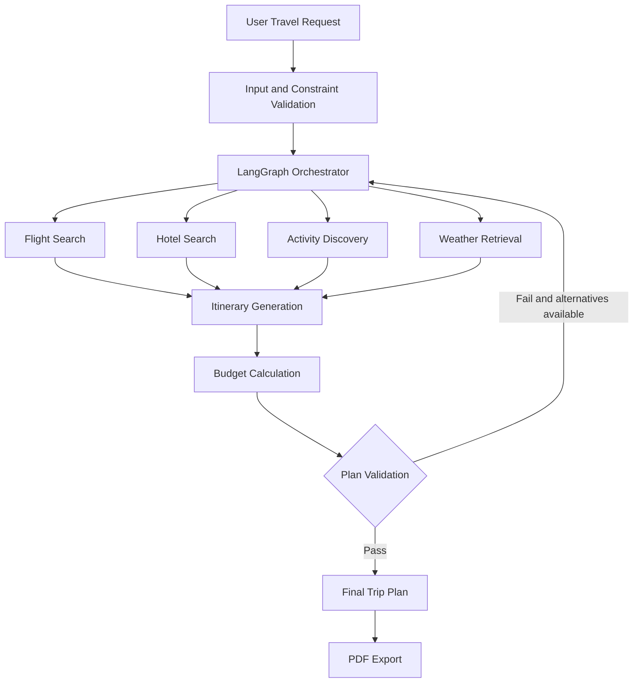

<div align="center">

# ✈️ TripWeaver

### AI-Powered Multi-Agent Budget Travel Planner

Plan smarter, travel better, and stay within budget.

TripWeaver coordinates specialized AI agents to transform your travel preferences, destination, dates, and budget into a structured itinerary with flight and accommodation options, estimated expenses, and a downloadable PDF report.

[](https://www.python.org/)
[](https://fastapi.tiangolo.com/)
[](https://www.langchain.com/langgraph)
[](https://streamlit.io/)
[](https://pytest.org/)

[**Launch TripWeaver**](https://tripweaver.streamlit.app/) · [**Explore API Documentation**](https://tripweaver-backend-vain.onrender.com/docs) · [**View Source Code**](https://github.com/iamwasay/TripWeaver)

</div>

---

## 📌 Overview

TripWeaver is a multi-agent travel planning application designed to help users organize trips according to their budget, travel dates, destination, interests, and accommodation preferences.

Rather than relying on a single large AI prompt, the application uses **LangGraph to coordinate nine specialized agents** through a structured workflow. The agents collect travel information, evaluate options, calculate expenses, construct an itinerary, and validate the resulting plan.

### Key Features

- **Flight Search:** Retrieve round-trip flight options through SerpApi.
- **Accommodation Discovery:** Find hotel options using Google Hotels data through SerpApi.
- **Activity Recommendations:** Discover attractions and estimate activity costs using Geoapify.
- **Weather Information:** Retrieve weather data for travel planning through OpenWeatherMap.
- **Budget Management:** Calculate trip expenses and convert currencies into the user's selected currency.
- **Intelligent Revision:** Reconsider available flight and accommodation options when a plan exceeds its budget.
- **Constraint Validation:** Check essential travel information and flag issues before presenting the plan.
- **Day-by-Day Itinerary:** Organize activities around travel dates, flight schedules, interests, and daily limits.
- **PDF Export:** Generate a downloadable, formatted travel report.
- **API Integration:** Expose trip-planning functionality through a FastAPI backend.
- **Audit Logging:** Use SQLAlchemy and SQLite to support application audit records.

> **Hosting note:** The frontend and backend use free hosting tiers. After a period of inactivity, the first request may take longer while a service starts up.

## 🌐 Live Application

| Component | Link |
|---|---|
| Web Application | [TripWeaver on Streamlit](https://tripweaver.streamlit.app/) |
| Backend API | [TripWeaver API Documentation](https://tripweaver-backend-vain.onrender.com/docs) |
| Source Code | [GitHub Repository](https://github.com/iamwasay/TripWeaver) |

---

## 🏗️ System Architecture

TripWeaver uses a shared `TripState` object to pass the travel request, retrieved results, budget calculations, validation details, and agent outputs through a LangGraph workflow.



*The workflow diagram represents the intended high-level process; exact execution order and retry behavior depend on the implemented graph.*

### The Nine Specialized Agents

| # | Agent | Responsibility | Primary Technology or Source |
|---:|---|---|---|
| 1 | Input / Constraint Agent | Validates the user's travel request, dates, and budget constraints. | Pydantic / application logic |
| 2 | Orchestrator Agent | Coordinates the workflow, manages shared state, and controls plan revisions. | LangGraph |
| 3 | Flight Agent | Retrieves round-trip flight options. | SerpApi |
| 4 | Stay Agent | Retrieves hotel and accommodation options. | Google Hotels via SerpApi |
| 5 | Activities Agent | Discovers attractions, estimates activity costs, and filters duplicates. | Geoapify |
| 6 | Weather Agent | Retrieves weather information relevant to the destination and travel period. | OpenWeatherMap |
| 7 | Budget Agent | Calculates expense totals and performs currency conversions using deterministic calculations. | Open-ER-API and application logic |
| 8 | Verification / Constraint Agent | Checks budget limits, required travel components, and applicable constraints. | Application logic |
| 9 | Itinerary Agent | Organizes activities into a day-by-day travel schedule. | Application logic |

---

## 🛡️ Validation and Error Handling

TripWeaver includes checks designed to reduce common travel-planning errors and improve the reliability of generated plans.

| Scenario | Intended Behavior |
|---|---|
| Budget exceeded | Reconsider available flight or hotel alternatives within the configured revision limit. |
| Flight or hotel unavailable | Flag missing required travel components during verification. |
| Late arrival or early departure | Adjust activity scheduling to account for arrival and departure times where supported. |
| Currency conversion unavailable | Report a conversion error instead of silently treating the exchange rate as `1.0`. |
| Activity price not verified | Identify the amount as an estimated cost rather than a verified ticket price. |
| Food and transport expenses | Include estimated expenses in the selected budget currency. |
| PDF generation | Produce a formatted report containing the available trip details and cost breakdown. |

**Important:** Flight availability, hotel prices, activity costs, and weather information depend on external data sources. Results may vary, and estimated prices should not be treated as guaranteed booking quotes.

---

## 🧰 Technology Stack

| Layer | Technologies |
|---|---|
| Programming Language | Python 3.12 |
| Backend Framework | FastAPI |
| Agent Orchestration | LangGraph |
| Data Validation | Pydantic |
| Database and Audit Records | SQLAlchemy, SQLite |
| Frontend | Streamlit, custom HTML/CSS |
| PDF Generation | `fpdf2` |
| Flight and Hotel Data | SerpApi |
| Places and Attractions | Geoapify |
| Weather Data | OpenWeatherMap |
| Currency Conversion | Open-ER-API |
| Testing | `pytest`, `unittest.mock` |

---

## 🚀 Getting Started

Follow these steps to run TripWeaver locally.

### Prerequisites

Install the following:

- Python 3.12
- Git
- A code editor such as VS Code or Cursor

API keys are required for the external services you intend to use.

### 1. Clone the Repository

```bash
git clone https://github.com/iamwasay/TripWeaver.git
cd TripWeaver
```

### 2. Create and Activate a Virtual Environment

Create the environment:

```bash
python -m venv .venv
```

**Windows PowerShell**

```powershell
.venv\Scripts\Activate.ps1
```

**macOS / Linux**

```bash
source .venv/bin/activate
```

### 3. Install Dependencies

Install the project's Python dependencies:

```bash
pip install -r requirements.txt
```

### 4. Configure Environment Variables

Create a `.env` file in the project root and add the API keys supported by your configuration.

```env
SERPAPI_API_KEY=your_serpapi_key
GEOAPIFY_API_KEY=your_geoapify_key
OPENWEATHER_API_KEY=your_openweather_key
```

Replace the example values with your actual credentials.

**Security:** Never commit your `.env` file or expose API keys in source code, screenshots, or public repositories. Confirm the exact environment-variable names against the application's configuration before running the project.

### 5. Start the Backend

Run the FastAPI development server:

```bash
uvicorn app.main:app --reload --port 8000
```

Open the following URL to access the interactive API documentation:

[http://127.0.0.1:8000/docs](http://127.0.0.1:8000/docs)

### 6. Start the Frontend

By default, the frontend is configured to communicate with the hosted backend. To use a locally running backend, set the backend URL before launching Streamlit.

**Windows PowerShell**

```powershell
$env:TRIPWEAVER_API_URL="http://127.0.0.1:8000"
streamlit run app.py
```

**macOS / Linux**

```bash
export TRIPWEAVER_API_URL=http://127.0.0.1:8000
streamlit run app.py
```

If your frontend entry point or configuration uses a different filename or environment variable, adjust these commands to match the repository.

### 7. Run the Tests

Execute the automated test suite:

```bash
pytest
```

The project documentation describes five offline tests using mocks to exercise selected functionality, including budget calculations, the revision workflow, and missing-flight detection. The actual test count and results depend on the current test suite.

---

## 🔌 API Reference

The hosted backend exposes the following documented endpoints.

| Method | Endpoint | Description |
|---|---|---|
| `GET` | `/api/v1/airports` | Returns airport options for origin and destination selection. |
| `POST` | `/api/v1/plan-trip` | Generates a trip plan from the supplied travel requirements. |

For the complete request schema, response model, and interactive testing interface, visit the [TripWeaver API documentation](https://tripweaver-backend-vain.onrender.com/docs).

### Example: Create a Trip Plan

The following request demonstrates a trip from Lahore to Dubai.

```bash
curl -X POST "https://tripweaver-backend-vain.onrender.com/api/v1/plan-trip" \
  -H "Content-Type: application/json" \
  -d '{
    "origin": "LHE",
    "destination": "DXB",
    "start_date": "2026-11-20",
    "end_date": "2026-11-25",
    "travelers": 2,
    "budget_amount": 350000,
    "budget_currency": "PKR",
    "accommodation_level": "mid-range",
    "interests": ["cultural", "food"],
    "pace": "moderate",
    "constraints": []
  }'
```

### Response Overview

| Field | Description |
|---|---|
| `trip_request` | The validated travel request. |
| `budget` | Expense totals, including flights, accommodation, activities, food, transport, miscellaneous expenses, grand total, and remaining budget. |
| `validation` | Validation status (`PASS` or `FAIL`) and any reported issues. |
| `itinerary` | Scheduled trip days and their activities, including available activity details. |
| `agent_messages` | Agent outputs and supporting information, including retrieved flight and hotel options where available. |

The exact response structure is defined by the backend's current Pydantic response models.

---

## ☁️ Deployment

TripWeaver separates the user interface from the API backend.

| Component | Hosting Platform |
|---|---|
| Frontend | Streamlit Community Cloud |
| Backend | Render |

The backend can also be deployed to a compatible Docker hosting platform. The Docker configuration specifies port `7860` for the containerized deployment.

### Deployment Considerations

- Configure required API keys through the hosting provider's environment-variable settings.
- Ensure the frontend points to the correct deployed backend URL.
- Review database storage and persistence requirements before relying on hosted audit records.
- Account for startup delays and request timeouts on free hosting tiers.
- Verify the deployed application and API after changing configuration or dependencies.

---

## 🧪 Testing

Automated tests help verify selected application behavior without relying on live third-party API responses.

The documented test coverage includes:

- Budget calculation behavior
- Budget revision workflow
- Detection of missing flight information
- Mocked dependencies for offline execution

Run the tests from the repository root:

```bash
pytest
```

For production use, broader integration testing is recommended for API failures, currency conversion, incomplete search results, itinerary constraints, database persistence, and PDF generation.

---

## ⚠️ Limitations and Disclaimers

- **Prices can change:** Flight and hotel prices may differ from the values returned during planning.
- **Estimates are not quotes:** Estimated activity, food, transport, and miscellaneous costs are planning figures, not guaranteed prices.
- **External services are required:** Data availability depends on third-party API access, rate limits, and service reliability.
- **Weather forecasts have limits:** Forecast availability depends on the requested travel dates and the data provider.
- **Validation is not a booking guarantee:** A plan passing application checks does not guarantee ticket availability, visa eligibility, hotel confirmation, or compliance with every real-world travel constraint.
- **Free hosting may sleep:** The first request after inactivity may take longer than subsequent requests.

Always verify essential travel details with the relevant airline, accommodation provider, attraction, and official travel authorities before booking.

---

## 🎯 Project Goal

TripWeaver demonstrates how a multi-agent architecture can combine external travel data, structured workflows, deterministic budget calculations, constraint validation, and itinerary generation in a practical travel-planning application.

The goal is to make trip planning more organized, transparent, and budget-aware while providing a foundation for further improvements in data quality, agent coordination, and travel validation.

---

<div align="center">

**✈️ TripWeaver — Plan your journey with clarity and confidence.**

[Launch App](https://tripweaver.streamlit.app/) · [API Documentation](https://tripweaver-backend-vain.onrender.com/docs) · [GitHub](https://github.com/iamwasay/TripWeaver)

</div>
